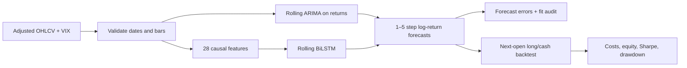

# Multi-Factor Time Series Forecasting

A reproducible Python research pipeline for forecasting equity log returns, comparing ARIMA with a PyTorch bidirectional LSTM, and evaluating the forecasts in a cost-aware trading simulation.

The project extends an ISE 537 coursework study of **NVDA and XOM** into a configurable, auditable research system. It produces forecasts for the next **1–5 trading observations**, using **28 causal OHLCV, momentum, volatility, and lagged VIX features** for the neural model. Each model is retrained on a rolling historical window.

**Scope:** a two-stock research case study with an offline synthetic demo and an optional Yahoo Finance data pipeline. A zero-return forecast and buy-and-hold trading benchmark provide reference points. The project does not establish performance across the S&P 500, and it does not connect to a broker.

## What is implemented

- **Data:** validated daily adjusted OHLC prices, volume, and VIX; explicit local caching and refresh controls.
- **Features:** trailing returns, price/moving-average ratios, realized volatility, RSI, MACD, intraday/overnight returns, volume signals, ATR, and one-session-lagged VIX predictors.
- **Models:** training-window BIC selection for ARIMA; a direct multi-horizon BiLSTM in PyTorch; a zero-return baseline.
- **Evaluation:** chronological rolling refits, training-only standardization, fully observed training labels, and per-origin audit records.
- **Trading simulation:** long/cash signals executed at the next observed open, 10 basis points per unit of one-way turnover by default, and a final liquidation cost.
- **Operations:** command-line workflows, Docker, automated checks, and a scheduled latest-forecast workflow.



## Quick start

Use Python 3.12 or newer in a fresh virtual environment. The reference setup and recorded experiments use Python 3.12.

```bash
git clone https://github.com/qichenz-0825/multi-factor-time-series-forecasting.git
cd multi-factor-time-series-forecasting
python -m venv .venv
source .venv/bin/activate
python -m pip install -r requirements.txt
python -m pip install -e '.[dev]'

# Runs all model types on fictional data; no network access required.
forecasting demo --output reports/demo

# Run the project checks.
python -m pytest -q
```

On Windows, activate the environment with `.venv\Scripts\activate`. The demo checks that the pipeline runs end to end. Its results are **synthetic**, not evidence of market performance.

## Research and latest forecasts

```bash
# Download the configured research period and evaluate all models.
forecasting run --config configs/research.json --output reports/research

# Reuse local CSV snapshots.
forecasting run --config configs/research.json --data-dir data/raw --output reports/research

# Deliberately replace cached inputs with a new vendor download.
forecasting run --config configs/research.json --refresh --output reports/research

# Refresh the data and generate forecasts from the latest available history.
forecasting update --config configs/research.json --output reports/latest
```

The default research configuration uses NVDA and XOM from **2015-01-02 through 2025-04-25**, with evaluation origins starting on **2024-04-23**. The download end date is exclusive. The rolling training window contains 504 observations; the BiLSTM sees 30 observations per input sequence. Models refit every five observed trading dates and forecast cumulative returns at horizons 1 through 5. Defaults use 10 training epochs, 32 hidden units per LSTM direction, and seed 42. These settings are reproducible starting points, not a claim of optimal tuning.

For local data, provide one CSV per configured ticker with columns `date,open,high,low,close,volume,vix`. Use consistently adjusted OHLC prices. Stock bars must be finite, chronologically sorted, unique, and internally consistent. Missing VIX values remain missing; the pipeline does not backfill unknown history. See [data provenance](docs/provenance.md) before obtaining or sharing vendor data.

Latest forecasts identify their actual observed origin and horizons in trading observations. They do not invent future session dates or score outcomes that have not occurred. A latest forecast is a research output, not a trading order.

### Generated artifacts

Each successful historical or demo run writes the following files to its output directory:

| Artifact | Contents |
| --- | --- |
| `RESULTS.md`, `performance.png` | Readable summary, equity curves, and drawdowns |
| `predictions.csv` | Origin, observed target date, horizon, prediction, realization, ticker, and model |
| `forecast_metrics.csv` | RMSE, MAE, and directional accuracy by ticker, model, and horizon |
| `metrics.json`, `<TICKER>_<model>_daily.csv` | Trading statistics and the daily position/turnover/return ledger |
| `training_audit.csv` | Training and prediction date cutoffs, sample counts, and fit diagnostics |
| `config.json`, `features.json` | Resolved experiment settings and feature definitions |
| `run_metadata.json` | Run status, mode, dependency versions, input coverage, and dataset checksums |

Latest-forecast runs produce predictions, training audit, feature/configuration files, and run metadata. They omit realized targets and backtest metrics. Confirm `status: "complete"` and the expected `mode` in `run_metadata.json` before interpreting any output; files left by a failed rerun are not a completed experiment.

### Docker and scheduled updates

```bash
docker build -t equity-forecast .
docker run --rm -v "$PWD/reports:/app/reports" \
  equity-forecast demo --output /app/reports/demo

# Requires network access to the data source.
docker run --rm -v "$PWD/reports:/app/reports" \
  equity-forecast run --config configs/research.json --output /app/reports/research
```

The [daily workflow](.github/workflows/daily.yml) is scheduled for **23:30 UTC on weekdays** and can also be started manually from GitHub Actions. It refreshes inputs, fits the latest forecasts, and uploads a `daily-forecasts` artifact retained for 30 days. It does not commit raw vendor data. The update command includes the current New York date only after an **18:00 America/New_York** publication buffer; earlier runs exclude that date. Weekends, exchange holidays, delayed vendor updates, or delayed Actions runs can leave the latest observed origin unchanged. The actual origin in the output is the source of truth.

The [CI workflow](.github/workflows/ci.yml) is configured to run linting, tests, the offline demo, and a Docker build/demo. A workflow definition is not itself evidence that its remote run has passed.

## How to interpret the results

### Recorded historical experiment

The checked-in [research results](reports/research/RESULTS.md) were generated with the default configuration, using 2,594 observations per stock. Forecast origins start on April 23, 2024; trading spans the April 24, 2024 open through the April 25, 2025 open. Each ticker has 50 rolling refits and 251 daily holding intervals. No parameters were adjusted to match the resume's performance figures.

| Stock | Model | Net Sharpe | Maximum drawdown | Total return |
| --- | --- | ---: | ---: | ---: |
| NVDA | ARIMA | 0.699 | -42.84% | 27.06% |
| NVDA | BiLSTM | 0.699 | -42.84% | 27.06% |
| XOM | ARIMA | -0.724 | -23.06% | -18.68% |
| XOM | BiLSTM | 0.042 | -13.93% | -1.02% |

NVDA's two strategies match because both models issued positive five-step forecasts at every origin and therefore remained long. Their forecasts are not identical. The XOM BiLSTM loses less than the ARIMA strategy in this sample, but neither model establishes a robust trading advantage from this experiment. Forecast errors for every horizon, baseline comparisons, training cutoffs, data hashes, and daily positions are included in the report files.


Forecast quality and trading performance answer different questions. The target is the cumulative **close-to-close log return** from the forecast origin. The strategy can enter only at the **following open**, so it cannot capture the preceding overnight gap. A smaller forecast error does not guarantee a higher strategy return.

Trading results are calculated separately for each ticker and model. The strategy is fully long when the selected horizon forecast exceeds the configured threshold and otherwise holds cash. Positions persist until the next signal. Sharpe uses daily arithmetic returns, 252 sessions per year, and a zero risk-free rate; maximum drawdown is a signed fraction from initial wealth of one. Buy-and-hold uses the same evaluation interval and is shown without transaction costs.

The resume's **1.45 Sharpe ratio and 12.4% maximum drawdown have not been independently reproduced** from the supplied coursework. They are not reported as achieved results of this implementation. See [resume alignment](docs/resume_alignment.md) for the distinction between verified functionality and historical claims.

## Research safeguards and limits

Training samples have labels fully observed at the forecast origin; scalers fit only the current training samples. The BiLSTM's two directions traverse the same already observed historical sequence. VIX is lagged one stock session, and rolling features never use future rows. See [methodology](docs/methodology.md) for the exact time boundaries.

These controls address implementation-level look-ahead, but downloaded adjusted history is a retrospective vendor dataset, not a point-in-time archive. Corporate-action adjustments and vendor corrections can revise historical values. The fixed choice of two surviving stocks introduces selection and survivorship limitations. The simulation also omits market impact, variable slippage, taxes, and interest on cash. Results must be interpreted within those assumptions.

## Repository guide

| Location | Purpose |
| --- | --- |
| `src/forecasting/` | Data, features, models, rolling evaluation, trading, and CLI |
| `configs/research.json` | Explicit historical experiment settings |
| `tests/` | Data, causality, model, and trading checks |
| `reports/` | Generated experiment artifacts; synthetic examples are labeled |
| `docs/methodology.md` | Targets, model fitting, chronology, and trading assumptions |
| `docs/provenance.md` | Coursework lineage, data source, and redistribution boundaries |
| `docs/resume_alignment.md` | Implemented capabilities and claim-verification status |

## 中文说明

本项目由 ISE 537 的 NVDA/XOM 股价预测课程研究扩展而来，现支持 28 个因果特征、ARIMA/PyTorch 双向 LSTM、多步对数收益预测、滚动训练及含交易成本的次日开盘回测。默认范围为两只股票，并非整个标普 500 股票池。`demo` 使用模拟数据；真实研究结果须由对应配置和数据运行生成。简历中的 Sharpe 1.45、最大回撤 12.4% 尚未复现，不能作为本版本已验证的业绩。详见[简历对应与验证说明](docs/resume_alignment.md)。
