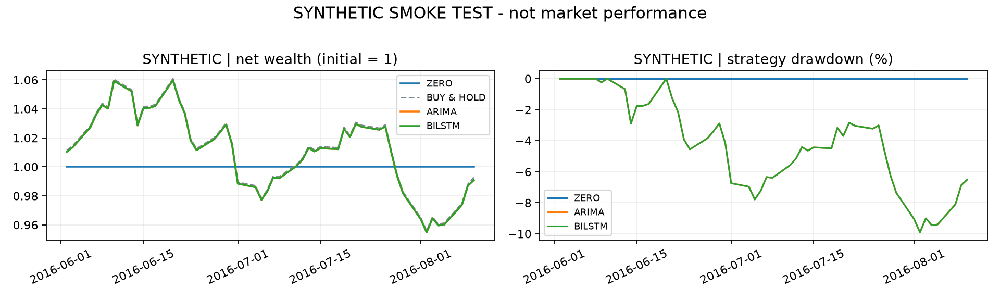

# Synthetic smoke test

Synthetic observations; these numbers are not market evidence.

| Ticker | Model | Sharpe | Max drawdown | Total return |
|---|---|---:|---:|---:|
| SYNTHETIC | zero | 0.000 | 0.00% | 0.00% |
| SYNTHETIC | arima | -0.187 | -9.91% | -0.92% |
| SYNTHETIC | bilstm | -0.187 | -9.91% | -0.92% |

See `config.json`, `run_metadata.json`, `training_audit.csv`, and daily ledgers for reproducibility.
10 bps one-way costs by default; signals execute next open. Sharpe uses 252 sessions and zero risk-free return.
