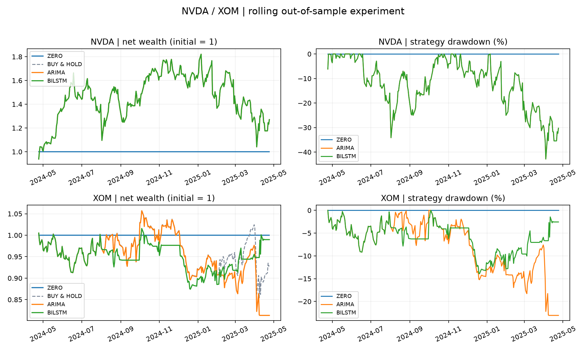

# Historical research run

Separate single-stock simulations; these are not combined portfolio returns.

| Ticker | Model | Sharpe | Max drawdown | Total return |
|---|---|---:|---:|---:|
| NVDA | zero | 0.000 | 0.00% | 0.00% |
| NVDA | arima | 0.699 | -42.84% | 27.06% |
| NVDA | bilstm | 0.699 | -42.84% | 27.06% |
| XOM | zero | 0.000 | 0.00% | 0.00% |
| XOM | arima | -0.724 | -23.06% | -18.68% |
| XOM | bilstm | 0.042 | -13.93% | -1.02% |

See `config.json`, `run_metadata.json`, `training_audit.csv`, and daily ledgers for reproducibility.
10 bps one-way costs by default; signals execute next open. Sharpe uses 252 sessions and zero risk-free return.
